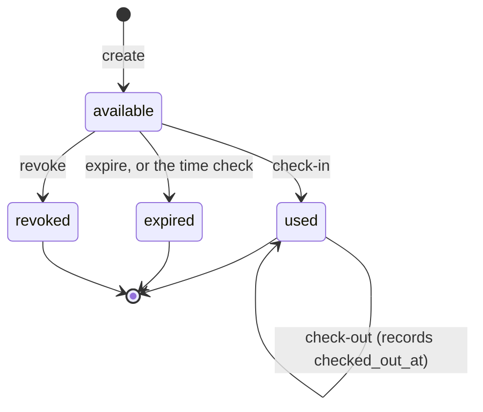

# API

The contract is [`openapi.yaml`](../openapi.yaml) **0.2.0**, served at `GET /openapi.yaml`. It holds
the full rules and an example for every answer; this page is the readable table. Each route in
`src/api.py` calls exactly one function in `src/db.py`.

**Only `spacey` calls Access** (ARCH-02; ADR 0005, proposed). Frontend and Purchase reach these
endpoints through `spacey`'s access functions, never directly, so all 6 require the service token.

| # | Method | Path | For (through `spacey`) | Route → function | Success | Refusals |
|---|---|---|---|---|---|---|
| 1 | POST | `/bookings/{booking_id}/access` | Purchase, after its paid check | `create_access` → `db.create_access` | `201` new `available` record; `200` the existing record, unchanged | `400` times missing or invalid; `401` |
| 2 | GET | `/bookings/{booking_id}/access` | Frontend (unlock page), Purchase | `read_access` → `db.read_access` | `200` the record | `401`; `404` |
| 3 | POST | `/bookings/{booking_id}/access/revoke` | Purchase, on cancel or refund | `revoke_access` → `db.revoke_access` | `200` `revoked` | `401`; `404`; `409` if `used` or `expired` |
| 4 | POST | `/bookings/{booking_id}/check-in` | Frontend | `check_in` → `db.check_in` | `200` `used` | `400` no code; `401`; `403` wrong code; `404`; `409` if `expired` or `revoked` |
| 5 | POST | `/bookings/{booking_id}/check-out` | Frontend | `check_out` → `db.check_out` | `200` still `used`, `checked_out_at` set once | `401`; `404`; `409` if not checked in |
| 6 | POST | `/bookings/{booking_id}/access/expire` | Purchase, the booking ended by its clock | `expire_access` → `db.expire_access` | `200` `expired` | `401`; `404`; `409` if `used` or `revoked` |
| — | GET | `/health` | platform, anyone | `health` → `db.ping` | `200 {status:"ok", revision}` | `503` database unreachable |
| — | GET | `/openapi.yaml` | anyone | `openapi` | `200` YAML | — |

Every success of 1–6 returns the **full record**: `booking_id`, `access_code`, `status`, `expires_at`,
`checked_in_at`, `checked_out_at`, `revoked_at`, `expired_at`.

## Lifecycle



- **Every transition starts from `available`.** `used`, `expired` and `revoked` are final.
- **Check-out changes no status.** It records `checked_out_at` on a `used` code, once. No re-entry.
- **Every write is safe to repeat:** repeating a call that already happened answers `200` with the same record.
- **Any other move is a `409`** `{"error", "status"}`, changes nothing and writes one log line without the code.
- **Time first:** on read, check-in and expire, an `available` record whose `expires_at` has passed becomes `expired` first.
- **Check-in order:** unknown booking `404`, wrong code `403` (says nothing about the status), the time check, then the status.

## Real mode today (Phase 2 closes these)

`src/db.py` has the 0.2.0 paths and names, but not yet the lifecycle (ARCH-02 kept real mode to the
renames). The mock (ARCH-01) follows the contract from the start.

| Function | Contract (0.2.0) | Real mode today |
|---|---|---|
| create | repeat: `200` with the same record; bad or naive times, or `end_time` ≤ `start_time`: `400` | repeat: `500` (primary key); only missing times are a `400` |
| read | time check first | no time check |
| revoke | only from `available`; repeat keeps `revoked_at` | any status; overwrites `revoked_at` |
| check-in | wrong code `403`; `used` → `200` same; `expired`/`revoked` → `409` | anything but a matching `available` record → `404` |
| check-out | stays `used`; not checked in → `409` | sets the status back to `available`; not checked in → `404` |
| expire | only from `available`; sets `expired_at` | any status; `expired_at` not set |
| all 6 | the full record; times ISO 8601 with an offset; `409` with `status` | partial records except read; Flask's date format (ARCH-01 fixes it); no `409` yet |

**Access → `spacey`:** when access expires by Access's own clock, `notify_purchase_expired(booking_id)`
(`src/purchase_client.py`) calls `POST {PURCHASE_URL}/bookings/{booking_id}/access-expired`. Nothing
is sent yet; the request it describes carries the same `Authorization: Bearer <token>` header. Both
sides can expire (Purchase's clock via `/access/expire`, Access's clock via this call); expiring twice
changes nothing.

The token is supplied to Access as `SERVICE_TOKEN` and sent by `spacey` as a Bearer token.
Provision it through platform and CI secret stores; never commit it. A missing or invalid token is a
`401` before the request body is read or the database is called.

## Conventions (same as `spacey`)

- JSON in and out. Errors are `{"error": "<message>"}`, and a `409` also carries `"status"`.
- Times are ISO 8601 with an offset.
- `booking_id` is `spacey`'s integer booking id: the only identifier shared between services.
- **Every write is safe to retry:** create, revoke, check-in, check-out and expire.
- **The code is in every record:** treat each answer as secret, and never log the `access_code`.

## Request bodies

```jsonc
// POST /bookings/{booking_id}/access   (create)
{ "start_time": "2026-10-20T09:00:00+07:00", "end_time": "2026-10-20T10:00:00+07:00" }

// POST /bookings/{booking_id}/check-in
{ "access_code": "3f9a0c1b" }
```

## Settled

- D2: `spacey` to Access uses the shared Bearer token, on all 6 access calls (0.2.0)

## Not decided
- D3: the base URL `spacey` uses to reach Access
- the exact wording of each refusal: Frontend decides what it shows
