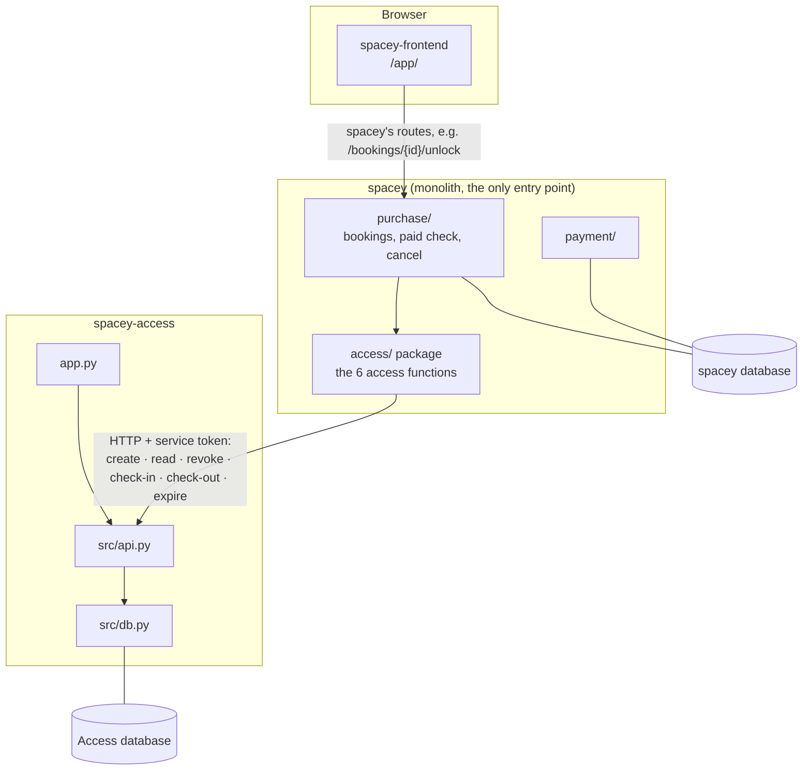
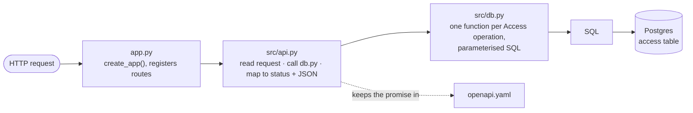

# Architecture

## Where Access sits

- **Who calls Access:** only `spacey`, through its access package (ARCH-02; ADR 0005, proposed).
  Purchase uses it to create access after its paid check, read it, revoke it on cancellation and
  expire it by Purchase's clock; Frontend's check-in and check-out reach it through `spacey`'s routes.
  So all 6 endpoints require the service token.
- **Who Access calls:** only `spacey`, to report that access expired by Access's clock (`src/purchase_client.py`; a dummy that sends nothing yet). It never reads `spacey`'s database. Anything it needs (booking id,
  start and end) is passed in.
- **Data:** Access has **its own database**, holding only the `access` table ([database.md](database.md)).

## Code layering

| Layer | Does | Must not |
|---|---|---|
| `app.py` | Build the Flask app, connect to the database, register `src/api.py` | Hold business rules |
| `src/api.py` | HTTP only: parse, validate shape, call `db.py`, answer exactly as `openapi.yaml` says | Run SQL |
| `src/db.py` | Each operation (create, read, revoke, check-in, check-out, expire) as SQL, with the rule checks next to the SQL that enforces them. The **only** file that talks to Postgres | Know about HTTP |
| `openapi.yaml` | The contract, served at `GET /openapi.yaml` | Drift from the code (tests check it) |

Since ACC-03 the routes live in `src/api.py` and the SQL in `src/db.py`; `app.py` only builds the app.
`tests/test_openapi.py` checks that the app serves exactly the routes in `openapi.yaml`.

## Run, build, deploy

| | Today | Planned |
|---|---|---|
| Local | `docker compose up`: app on `:8003`, Postgres on `:5434` | same |
| CI | tests (including `openapi.yaml` validity and its examples) + Docker build on every PR | + every response checked against `openapi.yaml`, real and mock mode (ARCH-01) |
| Deploy | none | its own Nomad job (D3: routing), with `/health` as the health check |
