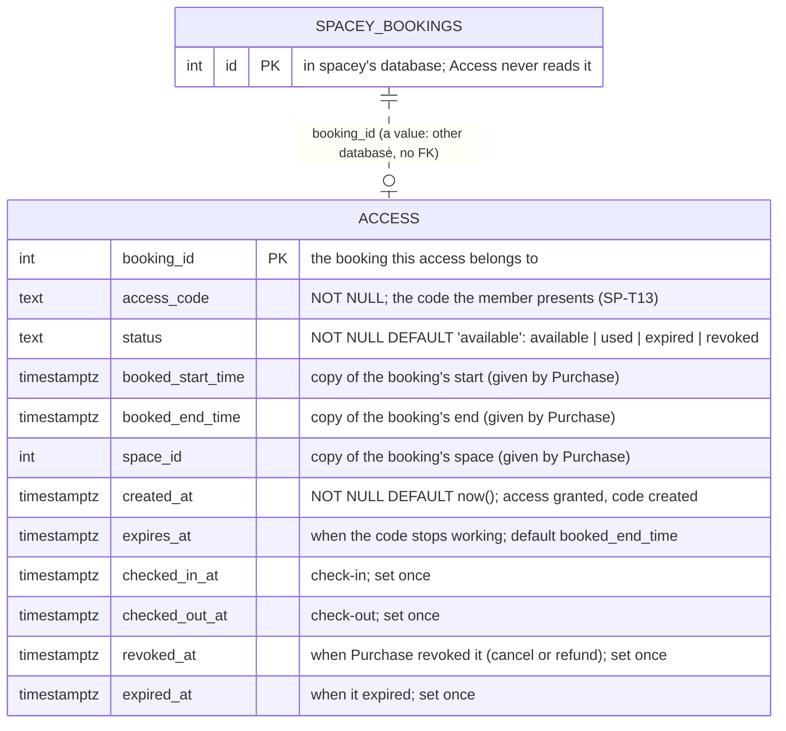
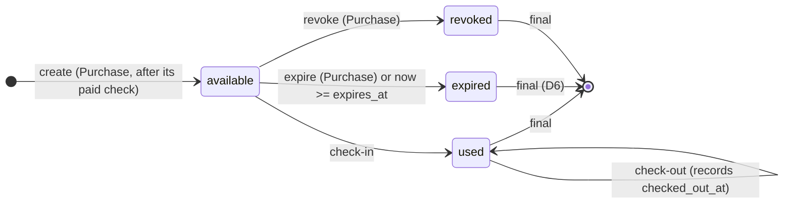

# Database

Access has **its own Postgres database** with one table, `access`. Its source of truth is the
migrations, applied in filename order:
[`001_create_access_table.sql`](../migrations/001_create_access_table.sql) creates the table, and
[`002_revoke_and_expiry.sql`](../migrations/002_revoke_and_expiry.sql) brings it to contract 0.2.0
(`revoked` and `revoked_at`, plus `expired_at`).

## Schema



The table after 001 and 002, for reading (the migrations are what runs):

```sql
CREATE TABLE access (
    booking_id          INTEGER      PRIMARY KEY,
    access_code         TEXT         NOT NULL,
    status              TEXT         NOT NULL DEFAULT 'available'
                                     CONSTRAINT access_status_check
                                     CHECK (status IN ('available', 'used', 'expired', 'revoked')),
    booked_start_time   TIMESTAMPTZ,
    booked_end_time     TIMESTAMPTZ,
    space_id            INTEGER,
    created_at          TIMESTAMPTZ  NOT NULL DEFAULT now(),
    expires_at          TIMESTAMPTZ,
    checked_in_at       TIMESTAMPTZ,
    checked_out_at      TIMESTAMPTZ,
    revoked_at          TIMESTAMPTZ,   -- renamed by 002
    expired_at          TIMESTAMPTZ    -- added by 002
);
```

| Column | Set when | Rule |
|---|---|---|
| `booking_id` | granting access | One record per booking (SP-R10). It's a value, not a foreign key: bookings live in another database |
| `access_code` | granting access, once | Reused on every request, never regenerated (SP-R10) |
| `status` | every state change | See the states below |
| `booked_start_time`, `booked_end_time`, `space_id` | granting access; Purchase may move the interval | Copies of Purchase's facts, so Access never has to read `spacey` |
| `created_at` | granting access | — |
| `expires_at` | granting access (= `booked_end_time`); moved with the interval | SP-T15, SP-R17 |
| `checked_in_at`, `checked_out_at` | check-in, check-out, **first time only** | No re-entry since 0.2.0: check-out keeps the status `used` |
| `revoked_at` | revoke (cancellation or refund), **first time only** | SP-R12 |
| `expired_at` | expiry, by Purchase's call or the time check, **first time only** | — |

**Naming:** `_time` for the copied interval, `_at` for events and the deadline. **D1:** the column is
`status`, as in the migration and Payments' table. `spacey`'s older `docs/access-table.md` says
`access_status`, so align that doc.

## States



Every transition starts from `available`. Any other move is refused with a `409` and changes nothing
(the full State × action table is in [`openapi.yaml`](../openapi.yaml)). The business-rules glossary
still has the old state name and re-entry; its update is a separate PR in `spacey-business-rules`.

## Rules the database work must keep

- **Never delete a row.** Revocation and expiry are states (SP-R12).
- **Refusals change nothing:** a refused check-in leaves the row exactly as it was.
- **Set-once times stay set:** a repeated revoke keeps the first `revoked_at`; the same for
  `checked_in_at`, `checked_out_at` and `expired_at`.
- **One record per booking, even under concurrent calls:** use `INSERT … ON CONFLICT (booking_id)`, or row locks for state changes.
- **Expiry is lazy:** checked when a row is touched (and optionally by a sweep). There's no scheduler (SP-R17).
- **Every migration is safe to run twice:** 001 with `IF NOT EXISTS`, 002 checks before each step.
  A migration that changes existing data never invents values: 002 keeps each cancellation's
  original time as `revoked_at`.

## Not decided

- D5: whether `space_id` is used to refuse a code at the wrong space
- D6: whether a later expiry may un-expire a row
- D7: how migrations run (by hand with `psql` today)
- whether `access_code` should be `UNIQUE`: not needed while every lookup also has the `booking_id`
