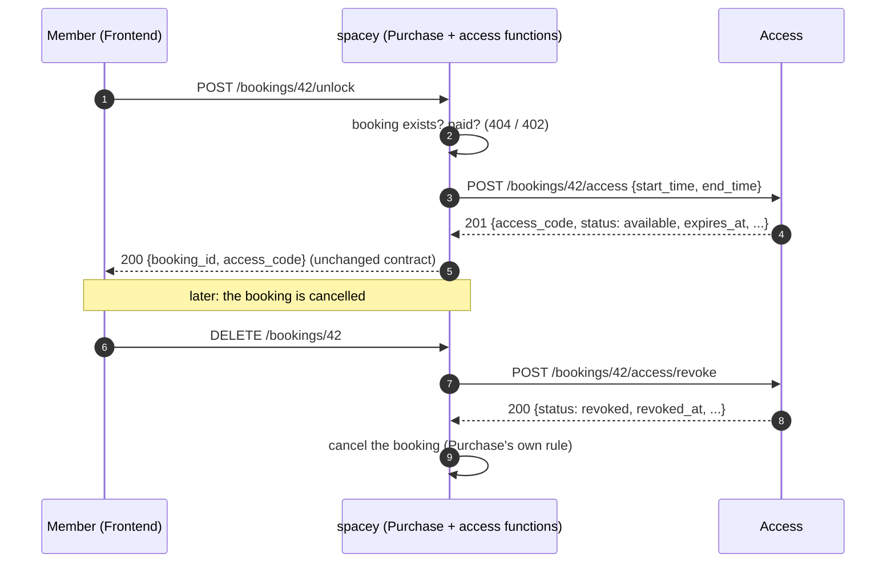

# For other teams: how to use Access

Short version: **go through `spacey`, never our database.** Since contract 0.2.0 (ARCH-02), `spacey`
is the only caller of Access: Purchase and Frontend use `spacey`'s access functions (its `access`
package), and those call our HTTP API with the service token. The contract is
[`openapi.yaml`](../openapi.yaml) (live at `GET /openapi.yaml`); [api.md](api.md) is the readable
table and lists what real mode doesn't do yet.

## Purchase (`spacey`)

| You do | Function → our endpoint | Notes |
|---|---|---|
| Grant access for a **paid** booking | `create_access` → `POST /bookings/{id}/access` with the booking's start and end | **You** check that the booking is paid; we don't. Safe to retry: `200` and the same record |
| Show the code again | `read_access` → `GET /bookings/{id}/access` | Any status; `404` if there's no record |
| Cancel or refund a booking | `revoke_access` → `POST /bookings/{id}/access/revoke` **before** your own cancel | Safe to retry. `409` once the code was used or expired. We keep the record |
| The booking ended (your clock) | `expire_access` → `POST /bookings/{id}/access/expire` | Safe to retry. `409` once used or revoked |
| *(we call you)* access ended (our clock) | `POST {PURCHASE_URL}/bookings/{id}/access-expired` | **You add this endpoint.** Not sent until it exists |

All 6 calls require `Authorization: Bearer <shared secret>`. Access reads the shared value from the
platform-provided `SERVICE_TOKEN`; requests without a matching token receive `401` before request
validation or database work. Provision the same value to `spacey` through the platform and its CI
secret store. Never put the secret in source control.

Access's future expiry notice to `spacey` will use that same token in the `Authorization: Bearer`
header.

**What we need you to agree:** the shared secret provisioning with SRE; when the code is created (at
payment, or at the first unlock as today); and what `/unlock` answers if Access is down (D4).

## Frontend (`spacey-frontend`)

Frontend never calls Access. It calls `spacey`'s routes, and `spacey` calls the access functions
(Phase 3 wires the routes; until then nothing changes for you).

| You want | `spacey` calls | Notes |
|---|---|---|
| Get the code (as today) | **unchanged:** `POST /bookings/{id}/unlock` on `spacey` | `spacey` uses read (and create) for it |
| Check in with a code | `check_in` → our `POST /bookings/{id}/check-in` `{access_code}` | `200` on success; `403` wrong code; `409` carries the status |
| Check out | `check_out` → our `POST /bookings/{id}/check-out` | The code stays `used`: no re-entry |

**Your call:** the shape of `spacey`'s check-in and check-out routes; our side of them is fixed in
`openapi.yaml`.

## Rules for everyone

- **Don't read or write the Access database.** Ask for an endpoint instead.
- **Treat `access_code` as a secret:** don't log it or put it in URLs.
- **Errors** are `{"error": "..."}`, and a `409` also carries `"status"`; times are ISO 8601 with an offset.
- **Changing the API** starts with a PR to `openapi.yaml` that the caller reviews. Code follows.
- **Check that we're up** with `GET /health` (200 ok, or 503 if our database is down).
