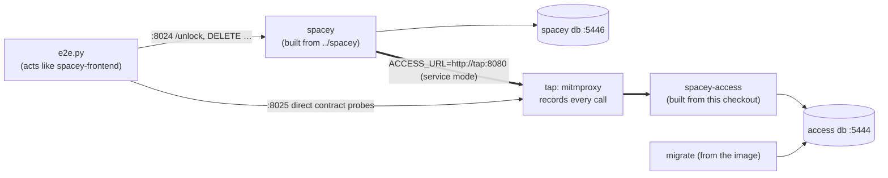

# Extraction gates (local orchestration)

Proves, step by step, that Access works as a separate service behind `spacey`, without
changing what `spacey:main` promises its callers. **Local only. Never in CI**: no workflow
references this directory, and nothing here pushes or deploys.



| Mode | `spacey`'s `ACCESS_URL` | Meaning |
|---|---|---|
| `local` | empty | `spacey` uses its own access table, as on `main` |
| `service` | `http://tap:8080` | `spacey` gets every access fact from `spacey-access`, through the tap |

## Run

```bash
orchestration/run.sh F2 service    # build both, start, run the F2 gate, tear down
KEEP=1 orchestration/run.sh F0 local   # leave the stack up to look around
```

- `spacey` is built from `../spacey`, or from `$SPACEY_DIR`.
- Needs Docker, `openssl` and a Python 3.12 venv with this repo's `requirements.txt` (`$PY`).
- Output goes to `/tmp/overnight/captures/<step>-<mode>/`:
  - `report.md`: checks and the recorded calls, **redacted**
  - `flows.jsonl`: raw captures, which **contain codes and the token**. Never commit them.

## What a gate checks (gates ③ and ④)

For every scenario:
1. **The answer** `spacey` gives the "browser": status, plus the shape in `spacey`'s own `openapi.yaml` (the frozen contract).
2. **The calls** the tap recorded: exactly which ones, with `Authorization: Bearer`, and with which body (e.g. one `/unlock` gives one `POST /bookings/{id}/access` carrying the booking's times).
3. **The state** in Access's database (read-only): the code given to the browser is the stored one, with the expected status.

Every recorded call is also validated against `spacey-access/openapi.yaml` with `openapi-core`. Contract gaps that a step hasn't fixed yet are reported as **known** (`KNOWN_CONTRACT` in `e2e.py`) and don't fail the gate. From F6 on, there are none.

## Steps

| Step | Adds to the gate |
|---|---|
| F0 | baseline: the frozen `/unlock` (404, 402, 200 with the same code twice) on the local path; direct contract probes |
| F1 | `spacey`'s access functions reach the real service (exec inside the `spacey` container) |
| F2 | `/unlock` in service mode: one create per unlock, booking times sent, same code, db matches; Access down → 503 |
| F3 | cancel → one revoke; db `revoked`; cancel unaffected when Access is down |
| F4 | old-path codes copied, then served unchanged in service mode |
| F5 | service mode never touches `spacey`'s access table; switching back works |
| F6 | the whole lifecycle table on the real service; no known contract gaps |
